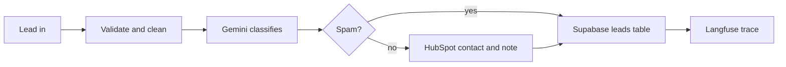

# BizBuzz Lead Qualification

An AI lead-qualification pipeline built for BizBuzz, a creative and technology studio. Every inbound lead is scored by an LLM, filed in a CRM, stored in SQL, and traced for observability.

It runs in production on the BizBuzz website, behind the Google Business Profile checker, as a Vercel server-side step. The same logic also exists as an n8n workflow.

## What it does

1. A lead arrives (website form submission or webhook).
2. The text is cleaned and validated. Bad emails are dropped.
3. Gemini classifies it with a strict JSON schema: spam or not, service wanted, score 1 to 10, urgency, budget signal, a short summary and a suggested next step.
4. Real leads are upserted into HubSpot (free CRM) as a contact with a note. Spam skips the CRM.
5. Every lead, spam included, is saved to a Supabase (Postgres) table.
6. The model call is logged to Langfuse with token counts.

## Design decisions

- **Never lose a lead.** If the model fails or returns bad JSON, the lead is saved with a neutral score and a "review manually" flag. The model call retries up to three times first.
- **Prompt injection resistance.** Lead text is wrapped as untrusted data and the prompt says never to follow instructions inside it. A test lead that tries to force a score of 10 is classified as spam.
- **Structured output.** Gemini is called with a response schema and enums, so the output is parsed, not guessed.
- **Observability is optional.** A Langfuse outage never blocks a lead.
- **Every service is optional in the Vercel version.** A missing key skips that step and logs which one, so it is safe to deploy before everything is configured.
- **Free-tier note.** The free Gemini tier may use inputs to improve models. Move to a paid key before sending sensitive client data.

## Repo layout

| Path | What it is |
| --- | --- |
| `vercel/lead-pipeline.ts` | Dependency-free TypeScript module used in production, called after the form's own email is sent |
| `n8n/bizbuzz-lead-qualification.n8n.json` | The same pipeline as an importable n8n workflow |
| `supabase/schema.sql` | `leads` table, `hot_leads` view, grants |
| `tests/` | Sample leads (good, vague, spam, injection, invalid) and a send script |
| `.env.example` | The variables the Vercel version reads |

## Setup (Vercel version)

1. Create a Supabase project and run `supabase/schema.sql`.
2. Create a HubSpot service key with `crm.objects.contacts.read` and `crm.objects.contacts.write` (and note write if your account asks for it).
3. Create a Langfuse project and copy the keys.
4. Set the variables from `.env.example` in your Vercel project settings.
5. Import `vercel/lead-pipeline.ts` into your app and call `runLeadPipeline({ email, phone, business, message, source })` inside Next.js `after()` so it runs after the response is sent.

## Setup (n8n version)

1. Import `n8n/bizbuzz-lead-qualification.n8n.json`.
2. Create five credentials in n8n: webhook secret (Header Auth `X-Webhook-Secret`), Gemini (Header Auth `x-goog-api-key`), HubSpot (Header Auth `Authorization: Bearer <token>`), Supabase, Langfuse (Basic Auth).
3. Run `tests/send_tests.sh` against the test webhook, then publish the workflow.

Expected on the sample leads: a clear web request scores 8 or higher, a job seeker scores low and is not spam, SEO and injection leads are spam and stay out of HubSpot, and the invalid email is dropped.

## Status

Tested with sample leads on both versions, and running in production on one real lead source. It has not yet processed a meaningful volume of real leads, so there are no conversion numbers to report.

## Author

Faraz Akhtar, AI Solutions Engineer.
